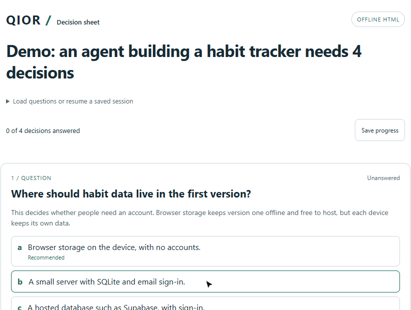
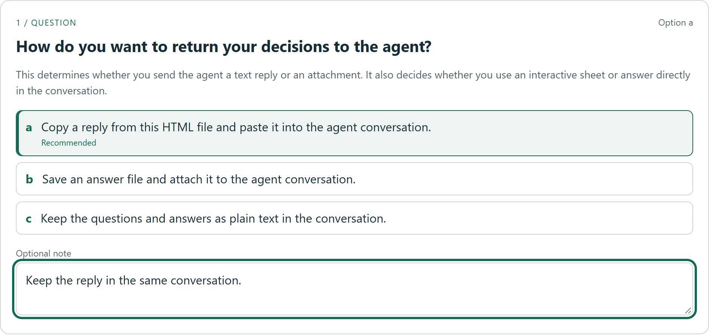
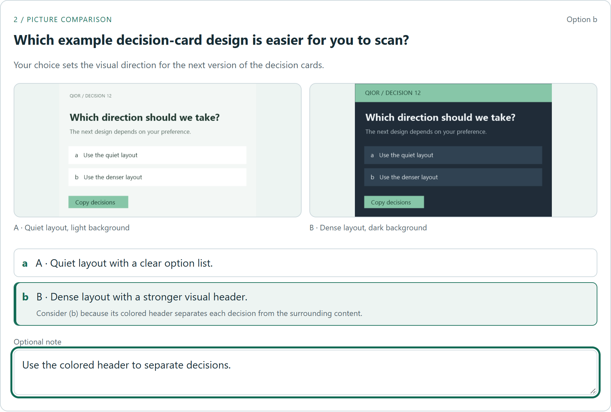
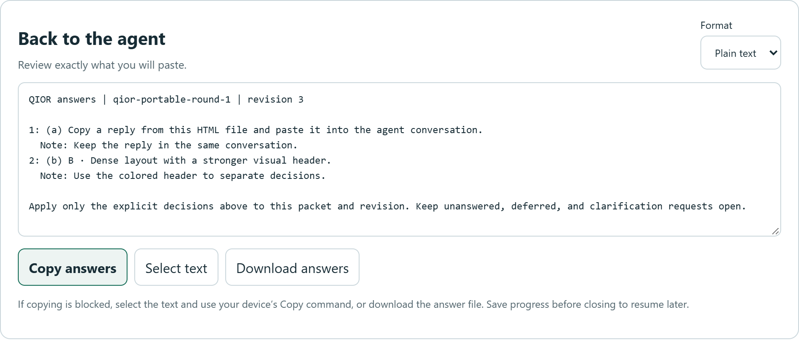

# Agent skills

Skills and steering notes for working with coding agents. Each skill lives
in its own folder and follows the [Agent Skills format](https://agentskills.io/specification).

## QIOR

A harness for the human that lets AI agents ask questions and collect decisions.

[Try the demo sheet](https://cdelog.github.io/skills/) in your browser, with
nothing to install. Install the skill with the [skills CLI](https://skills.sh):

```sh
npx skills add cdelog/skills --skill qior
```



QIOR, pronounced choir, means Question, Implications, Options, Recommendation.
An agent prepares a question sheet, you choose answers, then copy the reply
back into the conversation. Questions can include side by side pictures.

Each item contains one question sentence, one or two sentences explaining
what the answer influences, then two to four options. A comes first and
carries the recommendation when there is one. The optional note stays visible
after selection. Clicking a selected option again clears the selection.

Choose either format:

| Format | What it provides | Requirements |
| --- | --- | --- |
| [QIOR skill](skills/qior/SKILL.md) | Instructions, Node renderer, HTML template, and examples | Node.js 22 or later to generate files; a browser to answer |
| [QIOR steering note](steering/qior.md) | The same question format directly in the conversation | An agent instruction or steering file |

The skill is a complete folder. The agent supplies JSON and runs the renderer.
It does not need to write HTML for each sheet. The output embeds its pictures,
CSS, and scripts. It works locally with no QIOR server, account, API key, or
network requests. Copying or downloading answers is the return step.

## How it works

Pick an option and add a note when the agent needs more context. Selecting an
option hides the alternate controls. Click the option again to deselect it.



For a visual decision, compare the two pictures and choose a direction. Click
either picture to enlarge it near its original position on the page.



Copy the generated reply and send it back to the agent. It puts all responses
on one line, with question IDs, selected letters, and any quoted comments or
follow-up questions. Semicolons separate the responses.
Unanswered and deferred questions remain open.



These screenshots use the synthetic example packet included with the skill.

## Install the skill

The quickest way is the `npx skills add` command above. It installs into the
current project. Add `-g` to install it for your user instead. Or ask your agent:

```text
Install the qior skill from https://github.com/cdelog/skills into my user skills folder.
Copy the complete skills/qior folder, including scripts, assets, references, and examples.
```

Or copy `skills/qior/` yourself:

| Agent | User location | Project location |
| --- | --- | --- |
| Kiro | `~/.kiro/skills/qior/` | `.kiro/skills/qior/` |
| Claude Code | `~/.claude/skills/qior/` | `.claude/skills/qior/` |

For other agents, use their documented skill directory. Start a new chat after
installation so the agent can discover the skill. This repository does not
install itself or change your agent configuration.

The conventional `skills/qior/SKILL.md` layout also supports skill discovery
tools. The repository uses the same folder convention as
[pstack](https://github.com/cursor/plugins/tree/main/pstack),
[Anthropic's skills](https://github.com/anthropics/skills), and
[Vercel's agent skills](https://github.com/vercel-labs/agent-skills).
These links are format references, not dependencies or endorsements.

## Use the steering note

Copy [steering/qior.md](steering/qior.md) into your agent's steering directory,
or append its contents to an existing project instruction file. Preserve any
instructions already there. In Kiro, a project steering path is
`.kiro/steering/qior.md`.

The note is independent of the skill and requires no Node installation. Use
the skill when you want interactive HTML sheets and picture comparisons.

## Generate a sheet

With Node.js 22 or later installed, run these from the repository root.
No npm install is needed:

```sh
node skills/qior/scripts/qior.mjs render skills/qior/examples/questions.json --out output/decisions.html
```

Open `output/decisions.html` in a browser. For your own sheets, replace the
input with a question JSON file. The [packet guide](skills/qior/references/packet-format.md)
and [JSON schema](skills/qior/references/packet.schema.json) describe the input.
Image paths resolve relative to the input file and are embedded in the HTML.

Check an input packet or generate a reusable viewer:

```sh
node skills/qior/scripts/qior.mjs validate skills/qior/examples/questions.json
node skills/qior/scripts/qior.mjs viewer --out output/viewer.html
```

The viewer accepts question JSON or a saved progress file. Its answers live
in the current tab until you copy or save them. It uses no browser storage.

After installation, use the same commands with the absolute path to the
installed `scripts/qior.mjs`. The skill folder has everything it needs.

## Compatibility and limits

The renderer and its copied-skill workflow are tested with Node. Browser tests
cover local HTML, copy fallback, exports, saved progress, selection toggling,
picture positioning, and a phone-sized viewport. Actual skill loading in each
agent and opening attachments on physical phones need testing in those clients.

A mobile attachment preview may disable scripts. Open the file in a browser
that supports local HTML, or use the text steering format. An agent needs its
host's file attachment or download capability to deliver HTML remotely.

The sheet sends nothing automatically and does not resume an agent. Return
the answers through the originating conversation. A generated HTML or saved
progress file contains its question content and embedded pictures. Share it
only where you intend that content to go.

## Development

```sh
npm ci --ignore-scripts
npm test
npm run demo
npm run viewer
npx playwright install chromium
npm run test:browser
```

Playwright is a development dependency. It is not needed by installed skills
or included in generated HTML. To test an installed browser instead, set
`QIOR_BROWSER_CHANNEL` to a Playwright channel such as `msedge`.

To regenerate the README screenshots from the example packet, run
`npm run screenshots`. The capture script opens the generated local file and
uses only the synthetic example content.

The demo page renders [docs/demo/questions.json](docs/demo/questions.json),
a synthetic habit tracker packet. The Pages workflow publishes it on each push
to `main` that changes the skill or the demo. To regenerate the animation,
run `npm run demo:video` with a Chromium-based browser, then convert the
frames with [ffmpeg](https://ffmpeg.org):

```sh
cd output/demo-frames
ffmpeg -f concat -i frames.txt -vf "fps=15,split[a][b];[a]palettegen=max_colors=128:stats_mode=diff[p];[b][p]paletteuse=dither=none:diff_mode=rectangle" -loop 0 ../../docs/screenshots/demo.gif
```

Generated reports belong in `output/`, which Git ignores. Keep real decision
packets, screenshots, tokens, environment files, and machine-specific paths
out of contributions. See [SECURITY.md](SECURITY.md).

## Repository layout

```text
skills/qior/
  SKILL.md                 Agent instructions
  scripts/                 Node CLI, renderer, and response logic
  assets/                  Fixed HTML, CSS, and browser JavaScript
  examples/                Synthetic questions and pictures
  references/              Input guide and JSON schema
  LICENSE                  License retained when the folder is copied
steering/qior.md           Text-only instructions
docs/demo/                 Demo packet and pictures for the published page
tests/                     CLI, response, and browser checks
```

## License

MIT. See [LICENSE](LICENSE). The sample pictures are synthetic mockups created
for this project. No third-party skill text or scripts are bundled.
